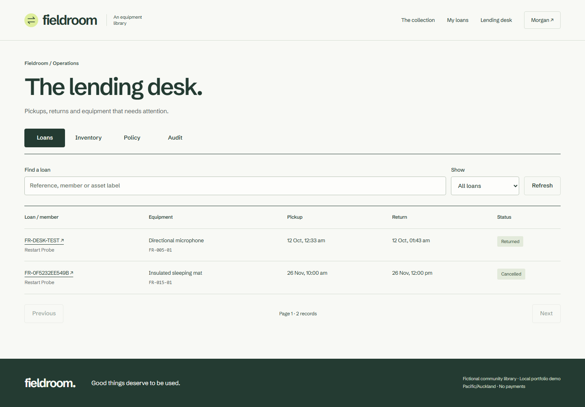

# Fieldroom

[](https://github.com/ammaar134/Live-Event-Operations/actions/workflows/verify.yml)

**Useful things, shared.** A complete local equipment-lending app for a fictional
club: 15 product models, 28 labelled copies, cameras, workshop tools and outdoor gear.
Built by Ammaar for a software-engineering portfolio. The repository retains the
user-supplied name `Live-Event-Operations`; this codebase is the separate Fieldroom
equipment application and contains no event-app or Remote Experiment Lab history.


Borrowers search the catalog, check dates, hold a specific asset, accept the policy,
confirm, reschedule atomically and cancel. Managers maintain inventory, block maintenance,
record pickups and returns, inspect damage, resolve overdue loans and review audit history.
Every visible action uses persisted API behavior. No payments, cloud services or accounts
are needed. All artwork is original and local; see [provenance](docs/ASSETS.md).
The interface uses locally hosted Schibsted Grotesk, a restrained forest/paper palette
and responsive equipment browsing. [Design research and typography decisions](docs/DESIGN.md).

## Run locally

Requirements: Git, Docker Desktop/Engine with Compose. For development/tests also use
[.NET SDK 10.0.401](https://dotnet.microsoft.com/en-us/download/dotnet/10.0) and
[Node 24.21.0](https://nodejs.org/dist/v24.21.0/). Versions and dependencies are pinned.

```powershell
git clone https://github.com/ammaar134/Live-Event-Operations.git
cd Live-Event-Operations
./scripts/setup.ps1
```

Open **http://localhost:5175**. Setup generates unique local credentials in ignored
`.env`; there is no published manager password. Register a member in the UI. For the
desk, use `desk@fieldroom.example` and `BOOTSTRAP_PASSWORD` from your own `.env`.
Seed data is repeatable; changing that environment variable later does not reset an
existing manager password. Compose stores PostgreSQL and session keys in dedicated
`fieldroom-equipment` volumes. Only the app is exposed, on loopback. To stop:
`docker compose down`. Removing volumes deletes this application's local data.

On systems without PowerShell, copy `.env.example` to `.env`, replace both placeholders
with distinct random passwords (manager: 12+ characters, mixed case, number, symbol),
then run `docker compose up --build --wait`. Do not commit that file.

## Native development

Use PostgreSQL **18.6**, a dedicated `fieldroom` database and login. Do not reuse another
application's database, secrets or ports. On Windows the optional official
[EDB binary ZIP](https://www.enterprisedb.com/download-postgresql-binaries) can be
extracted so `.tools/postgres/pgsql/bin/pg_ctl.exe` exists; then:

```powershell
./scripts/setup.ps1 -Native
npm ci --prefix web
./scripts/dev.ps1
# In a second terminal:
./scripts/web.ps1
```

Web **127.0.0.1:5175**, API **127.0.0.1:5085**, database **127.0.0.1:55435**. The setup
script initializes a dedicated cluster only if absent. The web helper also recognizes
the optional `.tools/node/node-v24.21.0-win-x64` runtime. If a port is occupied, change
this app's settings instead of stopping other projects. `scripts/dev.ps1` uses an
optional `.tools/dotnet` SDK if present, otherwise the installed pinned SDK.

On macOS/Linux or an existing native PostgreSQL install, create the separate database
and supply these process variables, using your own local values:

```text
ASPNETCORE_ENVIRONMENT=Development
ASPNETCORE_URLS=http://127.0.0.1:5085
ConnectionStrings__Library=Host=127.0.0.1;Port=55435;Database=fieldroom;Username=fieldroom;Password=YOUR_LOCAL_PASSWORD
BootstrapPassword=YOUR_LOCAL_MANAGER_PASSWORD
AutoMigrate=true
DataProtectionPath=/absolute/private/fieldroom-keys
```

Then run `dotnet run --project src/Api` and `npm run dev --prefix web`. Migration-only:
`dotnet run --project src/Api -- --migrate`. Development auto-migration also seeds the
catalog. No test clock or test-control endpoints exist. Health: `/health/live` and
database readiness at `/health/ready`.

## Verify

```text
npm ci --prefix web
npx --prefix web playwright install chromium
node scripts/verify.mjs
```

The aggregate command runs C# format checks and real PostgreSQL tests, Prettier,
ESLint, TypeScript/build, frontend tests, isolated browser journeys, dependency audits
and a reachable-history secret scan. The backend fixture defaults to Testcontainers;
alternatively set `TEST_POSTGRES` to an administrative **local test** connection string.
Each run creates/drops its own random database. Never use a production database login.

The browser runner creates its own `fieldroom_e2e_*` database, API port **5095**, web
port **5185**, unique manager password and processes, then removes them. It uses
`E2E_ADMIN_URL` (a PostgreSQL URL) or reads the ignored native `.env` on port 55435.
For Docker-only development, run verification through CI, or supply a separate local
test PostgreSQL instance; the application Compose database deliberately has no host port.

PowerShell with the optional native setup:

```powershell
./scripts/verify.ps1
```

Individual checks: `dotnet test tests/Api.Tests`, `npm run test --prefix web`,
`npm run build --prefix web`, `node scripts/browser-tests.mjs`.
[Verification scope and current evidence](docs/VERIFICATION.md). CI also builds the
container, starts Compose from an empty volume, checks readiness/catalog and runs
Gitleaks. Local success and remote CI are reported separately.

## Walkthrough

1. Browse the collection; filter by category and your Auckland-local pickup/return times.
2. Register a member. Open a product, choose its physical asset label, and place a hold.
3. Review the five-minute countdown, exact interval and accepted policy. Confirm, refresh,
   then inspect the durable reference/history. Change dates or cancel before the cutoff.
4. Sign in as the local manager. Use **Lending desk → Inventory** to edit/add equipment,
   schedule maintenance or retire a copy after resolving its commitments.
5. **Loans** lists pickups, returns and overdue loans. During the reserved interval,
   record pickup. Record a return with accessory and condition checks; damaged returns
   require inspection and turnaround. The automated desk test demonstrates this with
   an isolated fixture, without changing your system clock or exposing a test API.



## Engineering

React + TypeScript, ASP.NET Core + Identity, EF Core and PostgreSQL form one modular
monolith. PostgreSQL's `btree_gist` exclusion constraint is the final non-overlap guard.
Half-open requested intervals are separate from buffered `tstzrange` occupancy. All
occupancy changes lock the member and asset, sample fresh database time, and commit
allocation, audit and idempotency outcome together. Physical custody has its own unique
open-checkout guard. Availability reads are advisory; no worker is required for correctness.

See [architecture and ER diagram](docs/ARCHITECTURE.md),
[concurrency/expiry decision](docs/decisions/001-allocation.md),
[custody decision](docs/decisions/002-custody.md),
[auth decision](docs/decisions/003-auth.md), and [engineering case study](docs/CASE-STUDY.md).

| Capability | Public | Member | Manager |
| --- | --- | --- | --- |
| Catalog, policy, anonymized schedule | Yes | Yes | Yes |
| Own holds/bookings/history | — | Yes | Yes |
| Another member's private loan | — | — | Yes |
| Inventory, maintenance, policy, audit | — | — | Yes |
| Physical pickup/return/inspection | — | — | Yes |
| Assign roles from browser input | — | — | — |

| API area | Routes |
| --- | --- |
| Session | GET `/api/session`, `/api/session/csrf`; POST register/login/logout |
| Catalog | GET `/api/catalog`, `/api/products/{id}`, `/api/policy` |
| Member | POST `/api/holds`; GET `/api/bookings`, `/api/bookings/{id}` |
| Loan transition | POST `/api/bookings/{id}/{confirm,release,cancel,reschedule,pickup,return,no-show}` |
| Desk | GET bookings/inventory/audit; POST products/assets/maintenance/policy |

All POSTs require `X-CSRF-TOKEN`; domain mutations also require `Idempotency-Key`.
Time inputs use `yyyy-MM-ddTHH:mm` in **Pacific/Auckland**. Ambiguous/nonexistent DST
wall times are rejected. Requests never provide an owner identity. The frontend API
client demonstrates same-key recovery and fresh-intent handling.

## Boundaries

This is one organization, one physical asset per loan, no payments, uploads, email
delivery or 3D dependencies. Returns conservatively retain original buffered occupancy;
turnaround and inspection can temporarily prevent new holds. Idempotency/audit retention
cleanup is not implemented. A single borrowing-history response currently contains the
200 most recent records; desk/catalog queries paginate. [Deployment preparation](docs/DEPLOYMENT.md)
is documentation only. No live hosting, commercial usage or performance claims are made.

[MIT license](LICENSE), [security](SECURITY.md), [contributing](CONTRIBUTING.md).
