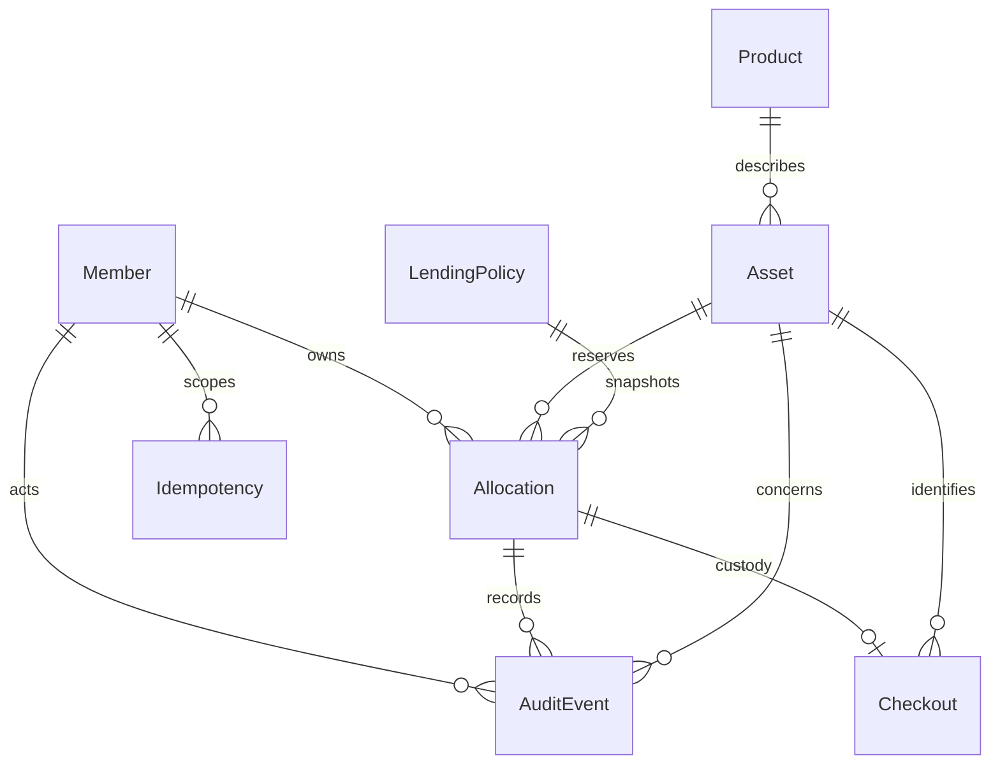

# Fieldroom architecture

React/TypeScript renders a same-origin browser application. Vite proxies `/api` in
native development; the ASP.NET image serves the built UI itself in Compose. ASP.NET
Identity handles membership. EF Core maps the modular monolith's catalog, allocation,
operations and audit entities to PostgreSQL. Explicit database transactions wrap the
domain service. No distributed cache, payment provider or background cleanup dependency.

Policy snapshots are JSON values on allocations, not a foreign key to mutable policy.
An allocation becomes a booking in place, with a unique durable reference. Public
schedule DTOs expose only asset, interval and occupied-until, never borrower identity.

Important boundaries are in `src/Api/Domain`, `Data` and `Features`. The locking and
idempotency implementation is `AllocationService`; API endpoints cannot assign private
owner IDs from input. See the focused [allocation](decisions/001-allocation.md),
[custody](decisions/002-custody.md), and [authentication](decisions/003-auth.md) decisions.

Metadata changes also use persisted idempotency. Policy changes take the exclusive
policy lock before the actor lock. Product edits take a product lock after the actor
lock and use optimistic version checks to reject stale forms. Business changes run
inside a savepoint: conflicts roll back side effects, then persist their outcome in
the outer transaction. Infrastructure/unknown-commit failures are recovered by the same
key. The browser coalesces in-flight duplicates, retains uncertain keys over refresh,
and starts a new attempt after a known outcome. Idempotency records currently have no
retention cleanup; deleting them would shorten the promised recovery window.

PostgreSQL 18.6, .NET SDK 10.0.401 / runtime and EF 10.0.12, Npgsql EF 10.0.3,
React 19.3.0, TypeScript 5.9.3, Node 24.21.0 and Vite 8.3.4 are pinned. TypeScript
5.9 is used within the verified supported typescript-eslint range. Lockfiles capture
all dependencies. See [asset provenance](ASSETS.md) for the original illustrations.
